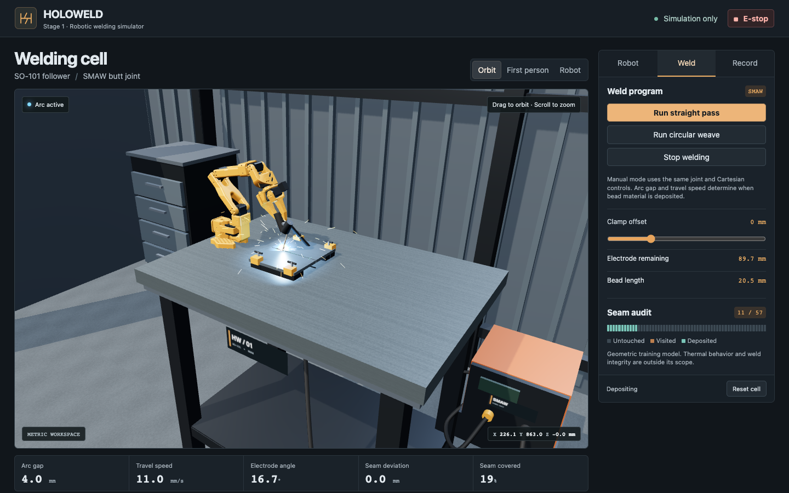
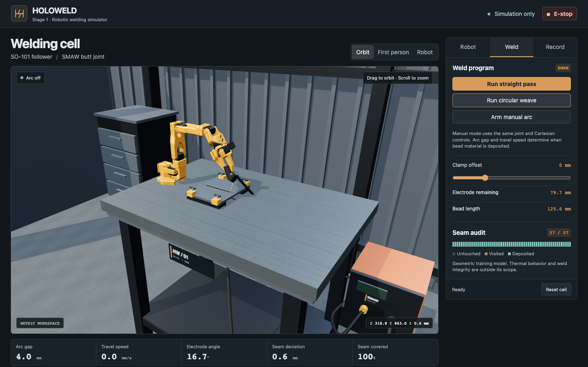

# HOLOWELD

A staged robotics project for capturing and reproducing welding motions. Stage 1 gives operators a repeatable desktop cell for practicing and reviewing simulated welds before hardware enters the workflow.



## Project stages

| Stage | What you can run |
| --- | --- |
| [Stage 1 · Welding simulation](stage-1-simulation/) | SO-101 robot controls, straight and circular weld passes, seam audit, and demonstration recording. |

## Start Stage 1

On macOS with Node.js and Google Chrome, clone this repository and run the launcher from its root:

```bash
./stage-1-simulation/launch.sh
```

Open **Weld → Run straight pass** to see the first run. Select **Reset cell** and run a weave to compare trajectories. The seam audit tracks which parts of the joint were visited while the arc was armed and which received a bead. You can export an operator demonstration with joint positions, input events, tip trajectories, optional camera observations, and the final seam audit.



HOLOWELD's workstation, browser controls, process simulation, seam audit, and recording pipeline were built for this project. The SO-101 geometry and joint limits come from the Apache-licensed Menagerie model. Stage 1 is a geometric simulator with no physical robot or welding equipment control. [Asset credits](stage-1-simulation/ASSET_LICENSES.md)

[Stage 1 guide](stage-1-simulation/README.md) · [Architecture](stage-1-simulation/ARCHITECTURE.md) · [Test results](stage-1-simulation/TEST_RESULTS.md)
