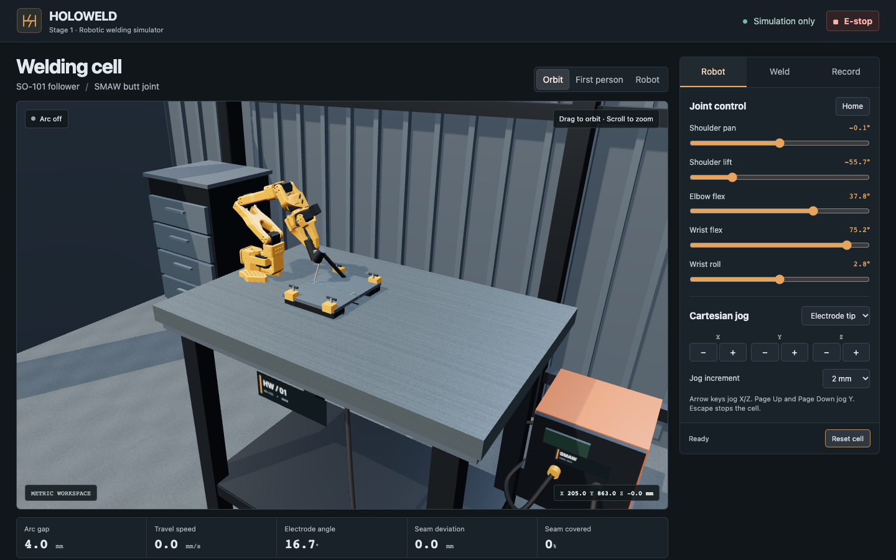
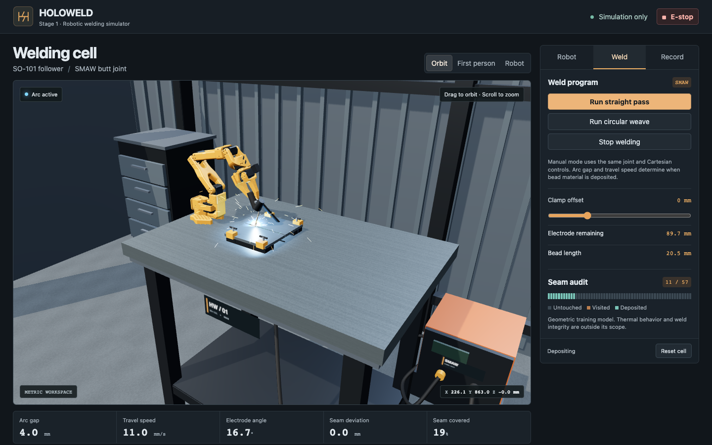

# Stage 1 · Welding simulation

HOLOWELD Stage 1 is a desktop robotic stick-welding simulator. Drive an SO-101 follower around a small steel butt joint, observe the virtual arc, and review where the electrode did and did not deposit material.



## Run on macOS

Install Node.js 22.18 or later and Google Chrome. From the repository root, run:

```bash
./stage-1-simulation/launch.sh
```

The launcher installs npm dependencies on first run and opens [the local simulator](http://127.0.0.1:4181/). Keep the terminal running while you use it. If the port is busy, pass `--port 4182 --open`.

## Run a weld

1. Open **Weld** and select **Run straight pass**. The robot tracks the joint, compensates for simulated electrode consumption, and deposits a bead when gap, angle, and travel speed are in range.
2. Read the **Seam audit** from start to finish. Gray bins are untouched, amber bins were visited while armed without deposition, and teal bins contain deposited material. The live metrics show gap, travel speed, tilt, deviation, and coverage.
3. Select **Reset cell**, then **Run circular weave**. Compare the bead length and path at the same joint.
4. For manual practice, use **Robot** to jog the electrode tip or end effector. Arrow keys jog X/Z and Page Up / Page Down jog Y when the viewport has focus. Arm the arc under **Weld**. **E-stop** or Escape halts simulated motion and extinguishes the arc.



## Capture a demonstration

Under **Record**, enable camera observations if desired, then start recording before the pass. Stop recording and export JSON to save joint states, operator events, the electrode trajectory, optional camera frames, and the final per-bin seam audit. The export captures the workpiece at the moment recording stops.

Orbit, first-person, and wrist views are available. The weld model is geometric and visual. Its coverage and bead dimensions are simulator measurements. Thermal behavior, metallurgy, and physical robot control are outside Stage 1.

[Architecture and export format](ARCHITECTURE.md) · [Verification](TEST_RESULTS.md) · [Asset licenses](ASSET_LICENSES.md)
